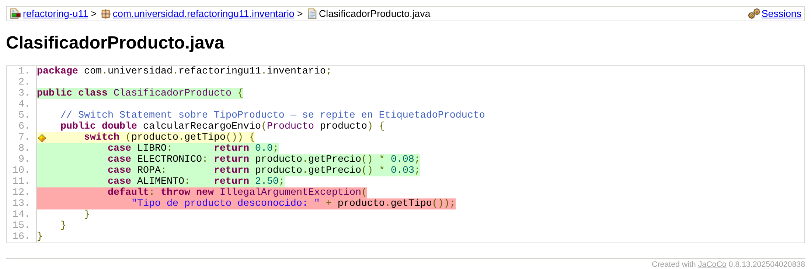
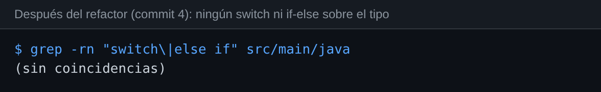
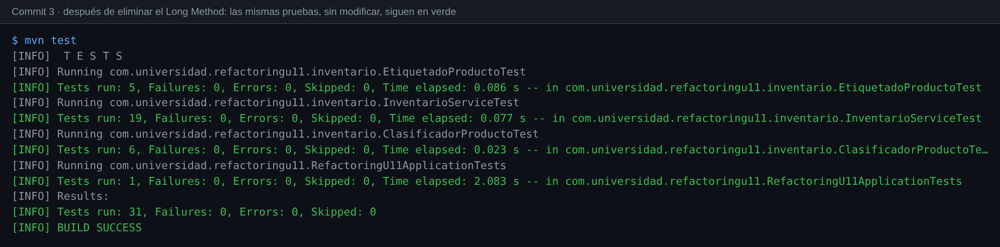
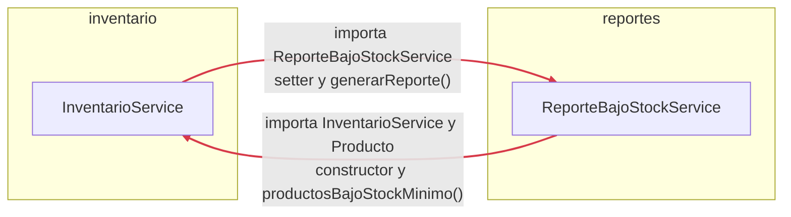
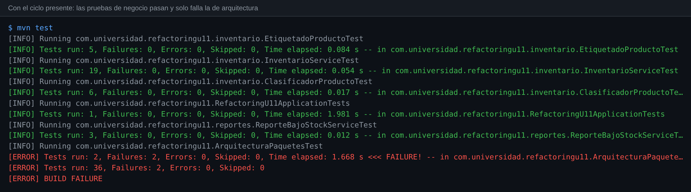

# Refactoring U11: refactorización guiada por pruebas

Post-contenido de la unidad 11 de Patrones de Diseño de Software (UDES). Nicolás Andrés Sánchez Villamizar.

Un servicio de inventario en Spring Boot con dos code smells reales. Primero los blindé con pruebas de caracterización y después los refactoricé sin tocar esas pruebas. En la Parte 2 le agregué un módulo de reportes que crea una dependencia cíclica entre paquetes, la detecté con una prueba de arquitectura y la resolví invirtiendo la dependencia. Todos los números de este README salen de ejecuciones reales en GitHub Actions: los registros completos están en [`docs/evidencias`](docs/evidencias) y las capturas en [`docs/capturas`](docs/capturas).

## Contenido

1. [Parte 1: red de seguridad y refactorización](#parte-1-red-de-seguridad-y-refactorización)
2. [Parte 2: acoplamiento entre paquetes](#parte-2-acoplamiento-entre-paquetes)
6. [Inconsistencias del enunciado y cómo las resolví](#inconsistencias-del-enunciado-y-cómo-las-resolví)
8. [Estructura, ejecución y herramientas](#estructura-ejecución-y-herramientas)

## Parte 1: red de seguridad y refactorización

### Los dos code smells de partida

El código original está tal como lo da la guía en el commit [`4a4a955`](https://github.com/NicolasSnchz/sanchez-post1-u11-patrones/commit/4a4a955d115bd9080fbc4c53208f807fd768fa06).

**Long Method en [`actualizarInventario()`](https://github.com/NicolasSnchz/sanchez-post1-u11-patrones/blob/4a4a955d115bd9080fbc4c53208f807fd768fa06/src/main/java/com/universidad/refactoringu11/inventario/InventarioService.java#L19-L62).** Son 44 líneas, con complejidad ciclomática 13 según JaCoCo, y seis bloques comentados que hacen cosas distintas: validar la entrada, buscar el producto, actualizar el stock, calcular la reorden, registrar el movimiento y decidir la alerta. Para entender por qué devuelve `OK_BAJO_STOCK_REORDEN_12` hay que leer el método entero.

**Switch Statements duplicados.** [`ClasificadorProducto`](https://github.com/NicolasSnchz/sanchez-post1-u11-patrones/blob/4a4a955d115bd9080fbc4c53208f807fd768fa06/src/main/java/com/universidad/refactoringu11/inventario/ClasificadorProducto.java#L7-L14) y [`EtiquetadoProducto`](https://github.com/NicolasSnchz/sanchez-post1-u11-patrones/blob/4a4a955d115bd9080fbc4c53208f807fd768fa06/src/main/java/com/universidad/refactoringu11/inventario/EtiquetadoProducto.java#L7-L14) tienen el mismo `switch` sobre `TipoProducto`, con las mismas cuatro ramas y la misma rama `default`. Las 8 líneas del `switch` (de las 16 que tiene cada clase, el 50 %) repiten la misma estructura y solo cambia lo que devuelve cada rama. Agregar un tipo de producto obliga a acordarse de editar las dos clases.


Le pasé además el detector de copia de PMD (CPD, con literales e identificadores ignorados) y no marcó la duplicación entre las dos clases: solo vio dos líneas parecidas dentro de `EtiquetadoProducto` ([`cpd/original.xml`](docs/evidencias/cpd/original.xml)). Tiene sentido: CPD busca texto copiado, y aquí lo repetido es la estructura de decisión, no el texto. Es justo la diferencia que hace Fowler entre Duplicated Code y Switch Statements, y por eso la evidencia de este smell es la comparación de las dos estructuras y no un porcentaje de CPD.

### La red de seguridad: pruebas de caracterización

Antes de tocar una línea escribí las pruebas en el commit [`8cd3f38`](https://github.com/NicolasSnchz/sanchez-post1-u11-patrones/commit/8cd3f38c68aa166ab9fbee0b97a8f39ec54f9627) y las corrí sobre el código original: **31 pruebas, todas en verde** (las 30 de caracterización y la `contextLoads` que genera Spring Initializr).


Las 12 pruebas de la guía están copiadas tal cual. Les agregué 18 más, porque una red de seguridad que solo cubre el camino feliz no avisa cuando el refactor cambia un borde. Con las 30, JaCoCo marca **el 100 % de las ramas de `actualizarInventario()`** (24 de 24) y todas las ramas alcanzables de los dos `switch`:


| Prueba | Qué comportamiento fija |
|---|---|
| Las 6 de la guía en [`InventarioServiceTest`](https://github.com/NicolasSnchz/sanchez-post1-u11-patrones/blob/8cd3f38c68aa166ab9fbee0b97a8f39ec54f9627/src/test/java/com/universidad/refactoringu11/inventario/InventarioServiceTest.java#L23) | Entrada, salida, stock insuficiente, reorden con su cantidad, tipo de movimiento inválido y producto inexistente |
| [`cantidadCero_retornaErrorYNoModificaStock`](https://github.com/NicolasSnchz/sanchez-post1-u11-patrones/blob/8cd3f38c68aa166ab9fbee0b97a8f39ec54f9627/src/test/java/com/universidad/refactoringu11/inventario/InventarioServiceTest.java#L61), [`productoIdNulo_retornaError`](https://github.com/NicolasSnchz/sanchez-post1-u11-patrones/blob/8cd3f38c68aa166ab9fbee0b97a8f39ec54f9627/src/test/java/com/universidad/refactoringu11/inventario/InventarioServiceTest.java#L67) | Las otras dos condiciones de la validación de entrada |
| [`tipoMovimientoNulo_lanzaNullPointerException`](https://github.com/NicolasSnchz/sanchez-post1-u11-patrones/blob/8cd3f38c68aa166ab9fbee0b97a8f39ec54f9627/src/test/java/com/universidad/refactoringu11/inventario/InventarioServiceTest.java#L72) | El original llama `tipoMovimiento.equals(...)` sin revisar `null`. Un refactor que cambie a `"ENTRADA".equals(...)` cambiaría el comportamiento y esta prueba lo atraparía |
| [`salida_queDejaElStockIgualAlMinimo_noActivaReorden`](https://github.com/NicolasSnchz/sanchez-post1-u11-patrones/blob/8cd3f38c68aa166ab9fbee0b97a8f39ec54f9627/src/test/java/com/universidad/refactoringu11/inventario/InventarioServiceTest.java#L78) | El borde de la reorden: con el stock justo en el mínimo no se reordena (`<` y no `<=`) |
| [`salida_deTodoElStock_dejaCeroYActivaReorden`](https://github.com/NicolasSnchz/sanchez-post1-u11-patrones/blob/8cd3f38c68aa166ab9fbee0b97a8f39ec54f9627/src/test/java/com/universidad/refactoringu11/inventario/InventarioServiceTest.java#L83), [`salida_deUnaUnidadMasQueElStock_retornaError`](https://github.com/NicolasSnchz/sanchez-post1-u11-patrones/blob/8cd3f38c68aa166ab9fbee0b97a8f39ec54f9627/src/test/java/com/universidad/refactoringu11/inventario/InventarioServiceTest.java#L89) | Los dos lados del borde de stock insuficiente: 20 de 20 se permite, 21 de 20 no |
| [`entrada_queNoAlcanzaElMinimo_activaReorden`](https://github.com/NicolasSnchz/sanchez-post1-u11-patrones/blob/8cd3f38c68aa166ab9fbee0b97a8f39ec54f9627/src/test/java/com/universidad/refactoringu11/inventario/InventarioServiceTest.java#L95) | La reorden también se activa con una entrada, no solo con salidas |
| [`entrada_conCantidadNegativa_restaSinValidarElStock`](https://github.com/NicolasSnchz/sanchez-post1-u11-patrones/blob/8cd3f38c68aa166ab9fbee0b97a8f39ec54f9627/src/test/java/com/universidad/refactoringu11/inventario/InventarioServiceTest.java#L103), [`salida_conCantidadNegativa_sumaAlStock`](https://github.com/NicolasSnchz/sanchez-post1-u11-patrones/blob/8cd3f38c68aa166ab9fbee0b97a8f39ec54f9627/src/test/java/com/universidad/refactoringu11/inventario/InventarioServiceTest.java#L110) | Un comportamiento raro del original: la revisión de stock negativo solo existe para SALIDA. No lo corrijo, porque corregirlo es cambiar comportamiento y no refactorizar, pero queda fijado para que el refactor no lo cambie sin querer |
| [`productosConIdRepetido_actualizaElPrimeroAgregado`](https://github.com/NicolasSnchz/sanchez-post1-u11-patrones/blob/8cd3f38c68aa166ab9fbee0b97a8f39ec54f9627/src/test/java/com/universidad/refactoringu11/inventario/InventarioServiceTest.java#L115) | La búsqueda se queda con el primer producto que coincide (el `break` del ciclo) |
| [`movimientoConReorden_imprimeElRegistroYLuegoLaAlerta`](https://github.com/NicolasSnchz/sanchez-post1-u11-patrones/blob/8cd3f38c68aa166ab9fbee0b97a8f39ec54f9627/src/test/java/com/universidad/refactoringu11/inventario/InventarioServiceTest.java#L123) y las dos siguientes | Lo que se imprime en consola y en qué orden. Es comportamiento observable y el refactor movía justo ese código |
| Las 4 de la guía en [`ClasificadorProductoTest`](https://github.com/NicolasSnchz/sanchez-post1-u11-patrones/blob/8cd3f38c68aa166ab9fbee0b97a8f39ec54f9627/src/test/java/com/universidad/refactoringu11/inventario/ClasificadorProductoTest.java#L11) más [`alimento_recargoFijoNoDependeDelPrecio`](https://github.com/NicolasSnchz/sanchez-post1-u11-patrones/blob/8cd3f38c68aa166ab9fbee0b97a8f39ec54f9627/src/test/java/com/universidad/refactoringu11/inventario/ClasificadorProductoTest.java#L37) | Los cuatro recargos. La prueba extra distingue el recargo fijo de uno porcentual: con un precio de 15 los dos podrían coincidir por casualidad |
| Las 2 de la guía en [`EtiquetadoProductoTest`](https://github.com/NicolasSnchz/sanchez-post1-u11-patrones/blob/8cd3f38c68aa166ab9fbee0b97a8f39ec54f9627/src/test/java/com/universidad/refactoringu11/inventario/EtiquetadoProductoTest.java#L11) más [`ropa_incluyeVerTalla`](https://github.com/NicolasSnchz/sanchez-post1-u11-patrones/blob/8cd3f38c68aa166ab9fbee0b97a8f39ec54f9627/src/test/java/com/universidad/refactoringu11/inventario/EtiquetadoProductoTest.java#L25) y [`alimento_incluyePerecedero`](https://github.com/NicolasSnchz/sanchez-post1-u11-patrones/blob/8cd3f38c68aa166ab9fbee0b97a8f39ec54f9627/src/test/java/com/universidad/refactoringu11/inventario/EtiquetadoProductoTest.java#L31) | Las cuatro etiquetas. La guía solo traía dos, pero su propio checkpoint pide las cuatro ramas en las dos clases |
| [`tipoNulo_lanzaNullPointerException`](https://github.com/NicolasSnchz/sanchez-post1-u11-patrones/blob/8cd3f38c68aa166ab9fbee0b97a8f39ec54f9627/src/test/java/com/universidad/refactoringu11/inventario/ClasificadorProductoTest.java#L43) en las dos clases | Con un tipo `null` el `switch` falla antes de llegar al `default`. Por eso la rama `default` nunca se ejecuta (JaCoCo la marca en rojo abajo) |



### Long Method: Extract Method con nombres que revelan intención

**Técnica:** Extract Method de Fowler, aplicado bloque por bloque y corriendo las pruebas después de cada extracción, más Replace Temp with Query para `necesitaReorden` y `cantidadReorden`, que en el original eran variables locales calculadas a mitad del método. Commit [`507b0cc`](https://github.com/NicolasSnchz/sanchez-post1-u11-patrones/commit/507b0cca155d5aae39de30ceea16ed9e82dc9b74).

El método quedó en [10 líneas](https://github.com/NicolasSnchz/sanchez-post1-u11-patrones/blob/507b0cca155d5aae39de30ceea16ed9e82dc9b74/src/main/java/com/universidad/refactoringu11/inventario/InventarioService.java#L17-L26) que se leen como el proceso del negocio, y complejidad 5:

```java
public String actualizarInventario(Long productoId, int cantidad, String tipoMovimiento) {
    if (!esSolicitudValida(productoId, cantidad, tipoMovimiento)) return "ERROR_DATOS_INVALIDOS";
    Producto producto = buscarProducto(productoId);
    if (producto == null) return "ERROR_PRODUCTO_NO_EXISTE";
    int nuevoStock = calcularNuevoStock(producto.getStock(), cantidad, tipoMovimiento);
    if (esSalidaSinStock(tipoMovimiento, nuevoStock)) return "ERROR_STOCK_INSUFICIENTE";
    producto.setStock(nuevoStock);
    registrarMovimiento(tipoMovimiento, cantidad, producto);
    return necesitaReorden(producto) ? solicitarReorden(producto) : "OK_" + nuevoStock;
}
```

| Responsabilidad que estaba mezclada | Ahora vive en |
|---|---|
| Validación de entrada | [`esSolicitudValida`](https://github.com/NicolasSnchz/sanchez-post1-u11-patrones/blob/507b0cca155d5aae39de30ceea16ed9e82dc9b74/src/main/java/com/universidad/refactoringu11/inventario/InventarioService.java#L28), con [`esEntrada`](https://github.com/NicolasSnchz/sanchez-post1-u11-patrones/blob/507b0cca155d5aae39de30ceea16ed9e82dc9b74/src/main/java/com/universidad/refactoringu11/inventario/InventarioService.java#L33) y [`esSalida`](https://github.com/NicolasSnchz/sanchez-post1-u11-patrones/blob/507b0cca155d5aae39de30ceea16ed9e82dc9b74/src/main/java/com/universidad/refactoringu11/inventario/InventarioService.java#L37) |
| Búsqueda del producto | [`buscarProducto`](https://github.com/NicolasSnchz/sanchez-post1-u11-patrones/blob/507b0cca155d5aae39de30ceea16ed9e82dc9b74/src/main/java/com/universidad/refactoringu11/inventario/InventarioService.java#L41) |
| Actualización de stock | [`calcularNuevoStock`](https://github.com/NicolasSnchz/sanchez-post1-u11-patrones/blob/507b0cca155d5aae39de30ceea16ed9e82dc9b74/src/main/java/com/universidad/refactoringu11/inventario/InventarioService.java#L48) y [`esSalidaSinStock`](https://github.com/NicolasSnchz/sanchez-post1-u11-patrones/blob/507b0cca155d5aae39de30ceea16ed9e82dc9b74/src/main/java/com/universidad/refactoringu11/inventario/InventarioService.java#L52) |
| Cálculo de la reorden | [`necesitaReorden`](https://github.com/NicolasSnchz/sanchez-post1-u11-patrones/blob/507b0cca155d5aae39de30ceea16ed9e82dc9b74/src/main/java/com/universidad/refactoringu11/inventario/InventarioService.java#L63) y [`calcularCantidadReorden`](https://github.com/NicolasSnchz/sanchez-post1-u11-patrones/blob/507b0cca155d5aae39de30ceea16ed9e82dc9b74/src/main/java/com/universidad/refactoringu11/inventario/InventarioService.java#L73) |
| Registro del movimiento | [`registrarMovimiento`](https://github.com/NicolasSnchz/sanchez-post1-u11-patrones/blob/507b0cca155d5aae39de30ceea16ed9e82dc9b74/src/main/java/com/universidad/refactoringu11/inventario/InventarioService.java#L56) |
| Alerta | [`solicitarReorden`](https://github.com/NicolasSnchz/sanchez-post1-u11-patrones/blob/507b0cca155d5aae39de30ceea16ed9e82dc9b74/src/main/java/com/universidad/refactoringu11/inventario/InventarioService.java#L67) y [`alertarBajoStock`](https://github.com/NicolasSnchz/sanchez-post1-u11-patrones/blob/507b0cca155d5aae39de30ceea16ed9e82dc9b74/src/main/java/com/universidad/refactoringu11/inventario/InventarioService.java#L77) |

Dos cuidados que las pruebas me obligaron a tener: `esSalidaSinStock` solo revisa las salidas, porque el original no revisa las entradas, y `esEntrada` sigue llamando `tipoMovimiento.equals(...)` para conservar el `NullPointerException`. Además de las pruebas, comparé el método original y el nuevo ejecutándolos lado a lado en 10.500 combinaciones de stock, mínimo, id, cantidad, tipo de movimiento e id repetido. Dieron el mismo resultado, el mismo stock final y la misma salida en consola en todas.

#### Decisión de diseño 1: la reorden se queda como método privado

Dejé `necesitaReorden` y `calcularCantidadReorden` como métodos privados de `InventarioService` y no extraje una `CalculadoraReorden`. Esa lógica es una regla de una línea (`stockMinimo * 3 - stock`, cuando el stock queda por debajo del mínimo), no tiene colaboradores, no varía por tipo de producto y tiene un solo consumidor. Una clase aparte significaría un archivo más, un bean o un `new` más y una dependencia que inyectar, para algo que hoy cabe en dos métodos con nombre propio. Es KISS y la regla de tres: no hay un segundo ni un tercer uso que justifique la abstracción.

Sí reconozco que tiene una razón de cambio propia: la política de compras no es la misma que la operación de bodega. Por eso la aislé en sus propios métodos y no la dejé en línea. La extraería a una clase en cuanto aparezca alguna de estas señales: que el multiplicador cambie por tipo de producto o por proveedor, o que otro componente necesite calcular la cantidad. 
### Switch Statements: Replace Conditional with Polymorphism sobre el enum

**Técnica:** Replace Conditional with Polymorphism de Fowler, usando el propio `enum` como jerarquía. Commit [`a98712b`](https://github.com/NicolasSnchz/sanchez-post1-u11-patrones/commit/a98712baab8a51feab676a8d861cc2b6e40122fd).

[`TipoProducto`](https://github.com/NicolasSnchz/sanchez-post1-u11-patrones/blob/a98712baab8a51feab676a8d861cc2b6e40122fd/src/main/java/com/universidad/refactoringu11/inventario/TipoProducto.java) ahora sabe calcular su recargo y armar su etiqueta, y las dos clases solo delegan. Las firmas `calcularRecargoEnvio(Producto)` y `generarEtiqueta(Producto)` no cambiaron:

```java
// ClasificadorProducto
public double calcularRecargoEnvio(Producto producto) {
    return producto.getTipo().calcularRecargoEnvio(producto.getPrecio());
}
```

```java
// TipoProducto (fragmento)
ELECTRONICO("ELECTRO", "Garantia 1 ano") {
    @Override
    public double calcularRecargoEnvio(double precio) {
        return precio * 0.08;
    }
},
```

Las dos condiciones no negociables de la guía se cumplen:

- **No queda ningún `switch` ni `if-else` sobre el tipo**, en ninguna clase:

  

- **Un tipo nuevo no toca `ClasificadorProducto` ni `EtiquetadoProducto`.** Se agrega una constante en el `enum`, y el compilador obliga a implementarle el recargo (el método es abstracto) y a pasarle los datos de la etiqueta (el constructor los pide). Con el `switch`, olvidar una de las dos clases solo se descubría en ejecución, por la rama `default`.

Complejidad de `calcularRecargoEnvio` y `generarEtiqueta` según JaCoCo: **de 5 a 1**. Comparé los recargos y las etiquetas de los cuatro tipos con diez precios distintos contra el código original, y dieron idénticos bit a bit.

#### Decisión de diseño 2: `enum` con comportamiento y no una interfaz de estrategia

Elegí métodos en el `enum` (una implementación por constante) en vez de una interfaz de estrategia con una clase por tipo, por tres razones:

- **El conjunto es cerrado y estable.** Los tipos de producto son parte del dominio y ya estaban enumerados; no los define un usuario ni llegan desde otro sistema.
- **Los comportamientos son funciones puras del precio y del nombre.** No necesitan colaboradores, así que no hace falta que Spring cree nada.
- **Todo lo que distingue a un tipo queda en un solo archivo**, y el compilador vigila que ningún tipo quede incompleto. Con estrategias serían cuatro clases por comportamiento más un mapa que las registre.

Dentro del `enum` usé las dos formas que da Java, según lo que varía. El recargo cambia de *forma* (un porcentaje del precio o un valor fijo), así que es un método abstracto que cada constante implementa. La etiqueta siempre tiene el mismo formato `[PREFIJO] nombre - leyenda` y solo cambian los textos, así que son datos del constructor y un único método. Hacerla abstracta habría repetido el formato cuatro veces, que era justo el problema de partida.

El costo que acepto es el que plantea la guía: las constantes de un `enum` no pueden recibir dependencias inyectadas por Spring. Si mañana el recargo de ELECTRONICO dependiera de un servicio de tarifas, pasaría a una interfaz `EstrategiaRecargo` con un `@Component` por tipo y un mapa por `TipoProducto`. Hoy esa jerarquía sería código para un futuro que nadie ha pedido (YAGNI).

### Resultado de las pruebas en cada paso

| Momento | Commit | `mvn test` | Pruebas de caracterización modificadas |
|---|---|---|---|
| Código original | [`8cd3f38`](https://github.com/NicolasSnchz/sanchez-post1-u11-patrones/commit/8cd3f38c68aa166ab9fbee0b97a8f39ec54f9627) | 31 pruebas, 0 fallos | (recién escritas) |
| Sin el Long Method | [`507b0cc`](https://github.com/NicolasSnchz/sanchez-post1-u11-patrones/commit/507b0cca155d5aae39de30ceea16ed9e82dc9b74) | 31 pruebas, 0 fallos | 0 |
| Sin el switch duplicado | [`a98712b`](https://github.com/NicolasSnchz/sanchez-post1-u11-patrones/commit/a98712baab8a51feab676a8d861cc2b6e40122fd) | 31 pruebas, 0 fallos | 0 |




Que las pruebas no se tocaron se puede comprobar con `git diff 8cd3f38 a98712b -- src/test`, que no devuelve nada.

## Parte 2: acoplamiento entre paquetes

### Paso 1: el módulo de reportes y el ciclo que introduce

En el commit [`2385f89`](https://github.com/NicolasSnchz/sanchez-post1-u11-patrones/commit/2385f89b96e8674fa1daf2bc4d71370b5b134bb1) agregué el paquete `reportes` y conecté `InventarioService` con `ReporteBajoStockService` por setter, como pide la guía. La guía deja `generarReporte()` sin implementar; yo lo implementé leyendo los productos bajo el mínimo que expone `InventarioService` con un método nuevo, [`productosBajoStockMinimo()`](https://github.com/NicolasSnchz/sanchez-post1-u11-patrones/blob/2385f89b96e8674fa1daf2bc4d71370b5b134bb1/src/main/java/com/universidad/refactoringu11/inventario/InventarioService.java#L26). La alerta ya no vive dentro de `actualizarInventario()`, porque en la Parte 1 quedó en [`alertarBajoStock()`](https://github.com/NicolasSnchz/sanchez-post1-u11-patrones/blob/2385f89b96e8674fa1daf2bc4d71370b5b134bb1/src/main/java/com/universidad/refactoringu11/inventario/InventarioService.java#L90), así que la llamada al reporte va ahí.

Todas las pruebas siguieron en verde (34), como dice la guía. El problema no lo ve ninguna prueba de negocio: los dos paquetes se importan mutuamente.



### Paso 2: diagnóstico con una prueba de arquitectura

[`ArquitecturaPaquetesTest`](https://github.com/NicolasSnchz/sanchez-post1-u11-patrones/blob/main/src/test/java/com/universidad/refactoringu11/ArquitecturaPaquetesTest.java), agregada en este commit, tiene la regla de la guía y una segunda que agregué:

- [`losPaquetesNoDebenTenerDependenciasCiclicas`](https://github.com/NicolasSnchz/sanchez-post1-u11-patrones/blob/main/src/test/java/com/universidad/refactoringu11/ArquitecturaPaquetesTest.java#L13): la de la guía, sin cambios.
- [`inventarioNoDebeDependerDeReportes`](https://github.com/NicolasSnchz/sanchez-post1-u11-patrones/blob/main/src/test/java/com/universidad/refactoringu11/ArquitecturaPaquetesTest.java#L23): fija la *dirección*. Sin ella, la prueba de ciclos también pasaría si alguien "arreglara" el ciclo al revés, haciendo que `reportes` deje de usar `inventario` mientras el dominio sigue importando el módulo de reportes. Además es literalmente lo que exige la rúbrica: que `inventario` no importe nada de `reportes`.

Las dos fallan, y ArchUnit dice exactamente por qué: `Cycle detected: Slice inventario -> Slice reportes -> Slice inventario`, con cada campo, parámetro y llamada que forma el ciclo.


En la misma ejecución, las 34 pruebas restantes pasan, incluidas todas las de la Parte 1. El código compila, el comportamiento es correcto y aun así el diseño está mal: un code smell no es un bug.



## Inconsistencias del enunciado y cómo las resolví

| Qué dice el enunciado | El problema | Cómo lo resolví |
|---|---|---|
| El checkpoint del Paso 2 pide cubrir las cuatro ramas del switch en ambas clases | `EtiquetadoProductoTest` solo trae LIBRO y ELECTRONICO | Agregué ROPA y ALIMENTO en el mismo commit de caracterización, antes de cualquier refactor |
| El mismo checkpoint habla de los "cuatro casos de retorno" de `actualizarInventario` | Son cinco: también está `ERROR_PRODUCTO_NO_EXISTE` | Están cubiertos los cinco |
| El primer commit hace `git add pom.xml src/main/java/...` | Deja fuera el `.gitignore` y el `application.properties` que genera Spring Initializr | Los incluí en el primer commit |
| "No marcar Add a README ni agregar .gitignore (el proyecto de Spring Initializr ya incluye ambos)" | Spring Initializr genera el `.gitignore` y un `HELP.md`, pero no un README | Escribí este README |
| El repositorio se llama `apellido-post1-u11` | | Lo llamé `sanchez-post1-u11-patrones` para mantener el mismo nombre que mis entregas anteriores |

## Estructura, ejecución y herramientas

```text
src/main/java/com/universidad/refactoringu11/
├── RefactoringU11Application.java
├── inventario/      Producto, TipoProducto, InventarioService, ClasificadorProducto, EtiquetadoProducto└── reportes/        ReporteBajoStockService
src/test/java/com/universidad/refactoringu11/
├── RefactoringU11ApplicationTests.java, ArquitecturaPaquetesTest.java├── inventario/      pruebas de caracterización└── reportes/        pruebas del reporte
docs/capturas        capturas de las ejecuciones reales
docs/evidencias      registros completos, reportes de JaCoCo y de CPD
```

```bash
mvn test                                    # toda la suite
mvn test -Dtest=ArquitecturaPaquetesTest    # solo la prueba de arquitectura
mvn verify                                  # pruebas y reporte de JaCoCo en target/site/jacoco
mvn spring-boot:run                         # arranca la aplicación (no expone web: arranca y termina)
```

**Herramientas:** Java 17 (probado también con JDK 23), Spring Boot 4.1.1, Maven, JUnit 5, ArchUnit 1.3.0, JaCoCo 0.8.13, PMD CPD, GitHub Actions, Git y GitHub.

