# Refactoring U11: refactorización guiada por pruebas

[](https://github.com/NicolasSnchz/sanchez-post1-u11-patrones/actions/workflows/ci.yml)

Post-contenido de la unidad 11 de Patrones de Diseño de Software (UDES). Nicolás Andrés Sánchez Villamizar.

Un servicio de inventario en Spring Boot con dos code smells reales. Primero los blindé con pruebas de caracterización y después los refactoricé sin tocar esas pruebas. En la Parte 2 le agregué un módulo de reportes que crea una dependencia cíclica entre paquetes, la detecté con una prueba de arquitectura y la resolví invirtiendo la dependencia. Todos los números de este README salen de ejecuciones reales en GitHub Actions: los registros completos están en [`docs/evidencias`](docs/evidencias) y las capturas en [`docs/capturas`](docs/capturas).

| | Antes | Después |
|---|---|---|
| Líneas de `actualizarInventario()` | 44 | **10** |
| Complejidad ciclomática de `actualizarInventario()` (JaCoCo) | 13 | **5** |
| `switch` sobre `TipoProducto` | 2, en dos clases | **0** |
| Ciclo entre los paquetes `inventario` y `reportes` | Sí (ArchUnit en rojo) | **No** (ArchUnit en verde) |
| Pruebas de caracterización de la Parte 1 | 30, en verde | **30, en verde y sin modificar** |
| Suite completa | 31 | **42, en verde con JDK 17 y JDK 23** |

## Contenido

1. [Parte 1: red de seguridad y refactorización](#parte-1-red-de-seguridad-y-refactorización)
2. [Parte 2: acoplamiento entre paquetes](#parte-2-acoplamiento-entre-paquetes)
3. [Lo que la guía no anticipó: un ciclo entre beans](#lo-que-la-guía-no-anticipó-un-ciclo-entre-beans)
4. [Evidencia](#evidencia)
5. [Checkpoints de la guía y dónde se cumplen](#checkpoints-de-la-guía-y-dónde-se-cumplen)
6. [Inconsistencias del enunciado y cómo las resolví](#inconsistencias-del-enunciado-y-cómo-las-resolví)
7. [Otras decisiones y limitaciones conocidas](#otras-decisiones-y-limitaciones-conocidas)
8. [Estructura, ejecución y herramientas](#estructura-ejecución-y-herramientas)
9. [Conclusiones](#conclusiones)

## Parte 1: red de seguridad y refactorización

### Los dos code smells de partida

El código original está tal como lo da la guía en el commit [`4a4a955`](https://github.com/NicolasSnchz/sanchez-post1-u11-patrones/commit/4a4a955d115bd9080fbc4c53208f807fd768fa06).

**Long Method en [`actualizarInventario()`](https://github.com/NicolasSnchz/sanchez-post1-u11-patrones/blob/4a4a955d115bd9080fbc4c53208f807fd768fa06/src/main/java/com/universidad/refactoringu11/inventario/InventarioService.java#L19-L62).** Son 44 líneas, con complejidad ciclomática 13 según JaCoCo, y seis bloques comentados que hacen cosas distintas: validar la entrada, buscar el producto, actualizar el stock, calcular la reorden, registrar el movimiento y decidir la alerta. Para entender por qué devuelve `OK_BAJO_STOCK_REORDEN_12` hay que leer el método entero.

**Switch Statements duplicados.** [`ClasificadorProducto`](https://github.com/NicolasSnchz/sanchez-post1-u11-patrones/blob/4a4a955d115bd9080fbc4c53208f807fd768fa06/src/main/java/com/universidad/refactoringu11/inventario/ClasificadorProducto.java#L7-L14) y [`EtiquetadoProducto`](https://github.com/NicolasSnchz/sanchez-post1-u11-patrones/blob/4a4a955d115bd9080fbc4c53208f807fd768fa06/src/main/java/com/universidad/refactoringu11/inventario/EtiquetadoProducto.java#L7-L14) tienen el mismo `switch` sobre `TipoProducto`, con las mismas cuatro ramas y la misma rama `default`. Las 8 líneas del `switch` (de las 16 que tiene cada clase, el 50 %) repiten la misma estructura y solo cambia lo que devuelve cada rama. Agregar un tipo de producto obliga a acordarse de editar las dos clases.

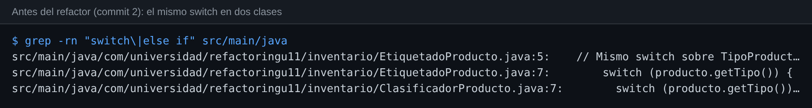

Le pasé además el detector de copia de PMD (CPD, con literales e identificadores ignorados) y no marcó la duplicación entre las dos clases: solo vio dos líneas parecidas dentro de `EtiquetadoProducto` ([`cpd/original.xml`](docs/evidencias/cpd/original.xml)). Tiene sentido: CPD busca texto copiado, y aquí lo repetido es la estructura de decisión, no el texto. Es justo la diferencia que hace Fowler entre Duplicated Code y Switch Statements, y por eso la evidencia de este smell es la comparación de las dos estructuras y no un porcentaje de CPD.

### La red de seguridad: pruebas de caracterización

Antes de tocar una línea escribí las pruebas en el commit [`8cd3f38`](https://github.com/NicolasSnchz/sanchez-post1-u11-patrones/commit/8cd3f38c68aa166ab9fbee0b97a8f39ec54f9627) y las corrí sobre el código original: **31 pruebas, todas en verde** (las 30 de caracterización y la `contextLoads` que genera Spring Initializr).

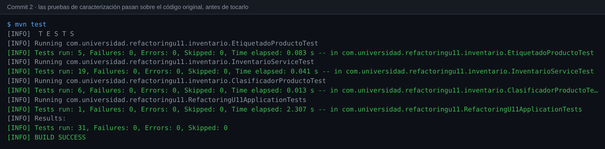

Las 12 pruebas de la guía están copiadas tal cual. Les agregué 18 más, porque una red de seguridad que solo cubre el camino feliz no avisa cuando el refactor cambia un borde. Con las 30, JaCoCo marca **el 100 % de las ramas de `actualizarInventario()`** (24 de 24) y todas las ramas alcanzables de los dos `switch`:

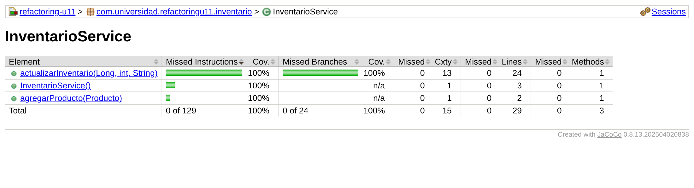

| Prueba | Qué comportamiento fija |
|---|---|
| Las 6 de la guía en [`InventarioServiceTest`](https://github.com/NicolasSnchz/sanchez-post1-u11-patrones/blob/8cd3f38c68aa166ab9fbee0b97a8f39ec54f9627/src/test/java/com/universidad/refactoringu11/inventario/InventarioServiceTest.java#L23) | Entrada, salida, stock insuficiente, reorden con su cantidad, tipo de movimiento inválido y producto inexistente |
| [`cantidadCero_retornaErrorYNoModificaStock`](https://github.com/NicolasSnchz/sanchez-post1-u11-patrones/blob/8cd3f38c68aa166ab9fbee0b97a8f39ec54f9627/src/test/java/com/universidad/refactoringu11/inventario/InventarioServiceTest.java#L61), [`productoIdNulo_retornaError`](https://github.com/NicolasSnchz/sanchez-post1-u11-patrones/blob/8cd3f38c68aa166ab9fbee0b97a8f39ec54f9627/src/test/java/com/universidad/refactoringu11/inventario/InventarioServiceTest.java#L67) | Las otras dos condiciones de la validación de entrada |
| [`tipoMovimientoNulo_lanzaNullPointerException`](https://github.com/NicolasSnchz/sanchez-post1-u11-patrones/blob/8cd3f38c68aa166ab9fbee0b97a8f39ec54f9627/src/test/java/com/universidad/refactoringu11/inventario/InventarioServiceTest.java#L72) | El original llama `tipoMovimiento.equals(...)` sin revisar `null`. Un refactor que cambie a `"ENTRADA".equals(...)` cambiaría el comportamiento y esta prueba lo atraparía |
| [`salida_queDejaElStockIgualAlMinimo_noActivaReorden`](https://github.com/NicolasSnchz/sanchez-post1-u11-patrones/blob/8cd3f38c68aa166ab9fbee0b97a8f39ec54f9627/src/test/java/com/universidad/refactoringu11/inventario/InventarioServiceTest.java#L78) | El borde de la reorden: con el stock justo en el mínimo no se reordena (`<` y no `<=`) |
| [`salida_deTodoElStock_dejaCeroYActivaReorden`](https://github.com/NicolasSnchz/sanchez-post1-u11-patrones/blob/8cd3f38c68aa166ab9fbee0b97a8f39ec54f9627/src/test/java/com/universidad/refactoringu11/inventario/InventarioServiceTest.java#L83), [`salida_deUnaUnidadMasQueElStock_retornaError`](https://github.com/NicolasSnchz/sanchez-post1-u11-patrones/blob/8cd3f38c68aa166ab9fbee0b97a8f39ec54f9627/src/test/java/com/universidad/refactoringu11/inventario/InventarioServiceTest.java#L89) | Los dos lados del borde de stock insuficiente: 20 de 20 se permite, 21 de 20 no |
| [`entrada_queNoAlcanzaElMinimo_activaReorden`](https://github.com/NicolasSnchz/sanchez-post1-u11-patrones/blob/8cd3f38c68aa166ab9fbee0b97a8f39ec54f9627/src/test/java/com/universidad/refactoringu11/inventario/InventarioServiceTest.java#L95) | La reorden también se activa con una entrada, no solo con salidas |
| [`entrada_conCantidadNegativa_restaSinValidarElStock`](https://github.com/NicolasSnchz/sanchez-post1-u11-patrones/blob/8cd3f38c68aa166ab9fbee0b97a8f39ec54f9627/src/test/java/com/universidad/refactoringu11/inventario/InventarioServiceTest.java#L103), [`salida_conCantidadNegativa_sumaAlStock`](https://github.com/NicolasSnchz/sanchez-post1-u11-patrones/blob/8cd3f38c68aa166ab9fbee0b97a8f39ec54f9627/src/test/java/com/universidad/refactoringu11/inventario/InventarioServiceTest.java#L110) | Un comportamiento raro del original: la revisión de stock negativo solo existe para SALIDA. No lo corrijo, porque corregirlo es cambiar comportamiento y no refactorizar, pero queda fijado para que el refactor no lo cambie sin querer |
| [`productosConIdRepetido_actualizaElPrimeroAgregado`](https://github.com/NicolasSnchz/sanchez-post1-u11-patrones/blob/8cd3f38c68aa166ab9fbee0b97a8f39ec54f9627/src/test/java/com/universidad/refactoringu11/inventario/InventarioServiceTest.java#L115) | La búsqueda se queda con el primer producto que coincide (el `break` del ciclo) |
| [`movimientoConReorden_imprimeElRegistroYLuegoLaAlerta`](https://github.com/NicolasSnchz/sanchez-post1-u11-patrones/blob/8cd3f38c68aa166ab9fbee0b97a8f39ec54f9627/src/test/java/com/universidad/refactoringu11/inventario/InventarioServiceTest.java#L123) y las dos siguientes | Lo que se imprime en consola y en qué orden. Es comportamiento observable y el refactor movía justo ese código |
| Las 4 de la guía en [`ClasificadorProductoTest`](https://github.com/NicolasSnchz/sanchez-post1-u11-patrones/blob/8cd3f38c68aa166ab9fbee0b97a8f39ec54f9627/src/test/java/com/universidad/refactoringu11/inventario/ClasificadorProductoTest.java#L11) más [`alimento_recargoFijoNoDependeDelPrecio`](https://github.com/NicolasSnchz/sanchez-post1-u11-patrones/blob/8cd3f38c68aa166ab9fbee0b97a8f39ec54f9627/src/test/java/com/universidad/refactoringu11/inventario/ClasificadorProductoTest.java#L37) | Los cuatro recargos. La prueba extra distingue el recargo fijo de uno porcentual: con un precio de 15 los dos podrían coincidir por casualidad |
| Las 2 de la guía en [`EtiquetadoProductoTest`](https://github.com/NicolasSnchz/sanchez-post1-u11-patrones/blob/8cd3f38c68aa166ab9fbee0b97a8f39ec54f9627/src/test/java/com/universidad/refactoringu11/inventario/EtiquetadoProductoTest.java#L11) más [`ropa_incluyeVerTalla`](https://github.com/NicolasSnchz/sanchez-post1-u11-patrones/blob/8cd3f38c68aa166ab9fbee0b97a8f39ec54f9627/src/test/java/com/universidad/refactoringu11/inventario/EtiquetadoProductoTest.java#L25) y [`alimento_incluyePerecedero`](https://github.com/NicolasSnchz/sanchez-post1-u11-patrones/blob/8cd3f38c68aa166ab9fbee0b97a8f39ec54f9627/src/test/java/com/universidad/refactoringu11/inventario/EtiquetadoProductoTest.java#L31) | Las cuatro etiquetas. La guía solo traía dos, pero su propio checkpoint pide las cuatro ramas en las dos clases |
| [`tipoNulo_lanzaNullPointerException`](https://github.com/NicolasSnchz/sanchez-post1-u11-patrones/blob/8cd3f38c68aa166ab9fbee0b97a8f39ec54f9627/src/test/java/com/universidad/refactoringu11/inventario/ClasificadorProductoTest.java#L43) en las dos clases | Con un tipo `null` el `switch` falla antes de llegar al `default`. Por eso la rama `default` nunca se ejecuta (JaCoCo la marca en rojo abajo) |


### Long Method: Extract Method con nombres que revelan intención

**Técnica:** Extract Method de Fowler, aplicado bloque por bloque y corriendo las pruebas después de cada extracción, más Replace Temp with Query para `necesitaReorden` y `cantidadReorden`, que en el original eran variables locales calculadas a mitad del método. Commit [`507b0cc`](https://github.com/NicolasSnchz/sanchez-post1-u11-patrones/commit/507b0cca155d5aae39de30ceea16ed9e82dc9b74).

El método quedó en [10 líneas](https://github.com/NicolasSnchz/sanchez-post1-u11-patrones/blob/507b0cca155d5aae39de30ceea16ed9e82dc9b74/src/main/java/com/universidad/refactoringu11/inventario/InventarioService.java#L17-L26) que se leen como el proceso del negocio, y complejidad 5:

```java
public String actualizarInventario(Long productoId, int cantidad, String tipoMovimiento) {
    if (!esSolicitudValida(productoId, cantidad, tipoMovimiento)) return "ERROR_DATOS_INVALIDOS";
    Producto producto = buscarProducto(productoId);
    if (producto == null) return "ERROR_PRODUCTO_NO_EXISTE";
    int nuevoStock = calcularNuevoStock(producto.getStock(), cantidad, tipoMovimiento);
    if (esSalidaSinStock(tipoMovimiento, nuevoStock)) return "ERROR_STOCK_INSUFICIENTE";
    producto.setStock(nuevoStock);
    registrarMovimiento(tipoMovimiento, cantidad, producto);
    return necesitaReorden(producto) ? solicitarReorden(producto) : "OK_" + nuevoStock;
}
```

| Responsabilidad que estaba mezclada | Ahora vive en |
|---|---|
| Validación de entrada | [`esSolicitudValida`](https://github.com/NicolasSnchz/sanchez-post1-u11-patrones/blob/507b0cca155d5aae39de30ceea16ed9e82dc9b74/src/main/java/com/universidad/refactoringu11/inventario/InventarioService.java#L28), con [`esEntrada`](https://github.com/NicolasSnchz/sanchez-post1-u11-patrones/blob/507b0cca155d5aae39de30ceea16ed9e82dc9b74/src/main/java/com/universidad/refactoringu11/inventario/InventarioService.java#L33) y [`esSalida`](https://github.com/NicolasSnchz/sanchez-post1-u11-patrones/blob/507b0cca155d5aae39de30ceea16ed9e82dc9b74/src/main/java/com/universidad/refactoringu11/inventario/InventarioService.java#L37) |
| Búsqueda del producto | [`buscarProducto`](https://github.com/NicolasSnchz/sanchez-post1-u11-patrones/blob/507b0cca155d5aae39de30ceea16ed9e82dc9b74/src/main/java/com/universidad/refactoringu11/inventario/InventarioService.java#L41) |
| Actualización de stock | [`calcularNuevoStock`](https://github.com/NicolasSnchz/sanchez-post1-u11-patrones/blob/507b0cca155d5aae39de30ceea16ed9e82dc9b74/src/main/java/com/universidad/refactoringu11/inventario/InventarioService.java#L48) y [`esSalidaSinStock`](https://github.com/NicolasSnchz/sanchez-post1-u11-patrones/blob/507b0cca155d5aae39de30ceea16ed9e82dc9b74/src/main/java/com/universidad/refactoringu11/inventario/InventarioService.java#L52) |
| Cálculo de la reorden | [`necesitaReorden`](https://github.com/NicolasSnchz/sanchez-post1-u11-patrones/blob/507b0cca155d5aae39de30ceea16ed9e82dc9b74/src/main/java/com/universidad/refactoringu11/inventario/InventarioService.java#L63) y [`calcularCantidadReorden`](https://github.com/NicolasSnchz/sanchez-post1-u11-patrones/blob/507b0cca155d5aae39de30ceea16ed9e82dc9b74/src/main/java/com/universidad/refactoringu11/inventario/InventarioService.java#L73) |
| Registro del movimiento | [`registrarMovimiento`](https://github.com/NicolasSnchz/sanchez-post1-u11-patrones/blob/507b0cca155d5aae39de30ceea16ed9e82dc9b74/src/main/java/com/universidad/refactoringu11/inventario/InventarioService.java#L56) |
| Alerta | [`solicitarReorden`](https://github.com/NicolasSnchz/sanchez-post1-u11-patrones/blob/507b0cca155d5aae39de30ceea16ed9e82dc9b74/src/main/java/com/universidad/refactoringu11/inventario/InventarioService.java#L67) y [`alertarBajoStock`](https://github.com/NicolasSnchz/sanchez-post1-u11-patrones/blob/507b0cca155d5aae39de30ceea16ed9e82dc9b74/src/main/java/com/universidad/refactoringu11/inventario/InventarioService.java#L77) |

Dos cuidados que las pruebas me obligaron a tener: `esSalidaSinStock` solo revisa las salidas, porque el original no revisa las entradas, y `esEntrada` sigue llamando `tipoMovimiento.equals(...)` para conservar el `NullPointerException`. Además de las pruebas, comparé el método original y el nuevo ejecutándolos lado a lado en 10.500 combinaciones de stock, mínimo, id, cantidad, tipo de movimiento e id repetido. Dieron el mismo resultado, el mismo stock final y la misma salida en consola en todas.

#### Decisión de diseño 1: la reorden se queda como método privado

Dejé `necesitaReorden` y `calcularCantidadReorden` como métodos privados de `InventarioService` y no extraje una `CalculadoraReorden`. Esa lógica es una regla de una línea (`stockMinimo * 3 - stock`, cuando el stock queda por debajo del mínimo), no tiene colaboradores, no varía por tipo de producto y tiene un solo consumidor. Una clase aparte significaría un archivo más, un bean o un `new` más y una dependencia que inyectar, para algo que hoy cabe en dos métodos con nombre propio. Es KISS y la regla de tres: no hay un segundo ni un tercer uso que justifique la abstracción.

Sí reconozco que tiene una razón de cambio propia: la política de compras no es la misma que la operación de bodega. Por eso la aislé en sus propios métodos y no la dejé en línea. La extraería a una clase en cuanto aparezca alguna de estas señales: que el multiplicador cambie por tipo de producto o por proveedor, o que otro componente necesite calcular la cantidad. La Parte 2 puso a prueba esta decisión: el módulo de reportes necesitaba la cantidad, y como la notificación por evento se la entrega ya calculada ([Decisión 4](#decisión-de-diseño-4-notificar-por-evento-y-no-por-lote)), no tuvo que recalcularla y la decisión siguió siendo válida.
### Switch Statements: Replace Conditional with Polymorphism sobre el enum

**Técnica:** Replace Conditional with Polymorphism de Fowler, usando el propio `enum` como jerarquía. Commit [`a98712b`](https://github.com/NicolasSnchz/sanchez-post1-u11-patrones/commit/a98712baab8a51feab676a8d861cc2b6e40122fd).

[`TipoProducto`](https://github.com/NicolasSnchz/sanchez-post1-u11-patrones/blob/a98712baab8a51feab676a8d861cc2b6e40122fd/src/main/java/com/universidad/refactoringu11/inventario/TipoProducto.java) ahora sabe calcular su recargo y armar su etiqueta, y las dos clases solo delegan. Las firmas `calcularRecargoEnvio(Producto)` y `generarEtiqueta(Producto)` no cambiaron:

```java
// ClasificadorProducto
public double calcularRecargoEnvio(Producto producto) {
    return producto.getTipo().calcularRecargoEnvio(producto.getPrecio());
}
```

```java
// TipoProducto (fragmento)
ELECTRONICO("ELECTRO", "Garantia 1 ano") {
    @Override
    public double calcularRecargoEnvio(double precio) {
        return precio * 0.08;
    }
},
```

Las dos condiciones no negociables de la guía se cumplen:

- **No queda ningún `switch` ni `if-else` sobre el tipo**, en ninguna clase:

  

- **Un tipo nuevo no toca `ClasificadorProducto` ni `EtiquetadoProducto`.** Se agrega una constante en el `enum`, y el compilador obliga a implementarle el recargo (el método es abstracto) y a pasarle los datos de la etiqueta (el constructor los pide). Con el `switch`, olvidar una de las dos clases solo se descubría en ejecución, por la rama `default`.

Complejidad de `calcularRecargoEnvio` y `generarEtiqueta` según JaCoCo: **de 5 a 1**. Comparé los recargos y las etiquetas de los cuatro tipos con diez precios distintos contra el código original, y dieron idénticos bit a bit.

#### Decisión de diseño 2: `enum` con comportamiento y no una interfaz de estrategia

Elegí métodos en el `enum` (una implementación por constante) en vez de una interfaz de estrategia con una clase por tipo, por tres razones:

- **El conjunto es cerrado y estable.** Los tipos de producto son parte del dominio y ya estaban enumerados; no los define un usuario ni llegan desde otro sistema.
- **Los comportamientos son funciones puras del precio y del nombre.** No necesitan colaboradores, así que no hace falta que Spring cree nada.
- **Todo lo que distingue a un tipo queda en un solo archivo**, y el compilador vigila que ningún tipo quede incompleto. Con estrategias serían cuatro clases por comportamiento más un mapa que las registre.

Dentro del `enum` usé las dos formas que da Java, según lo que varía. El recargo cambia de *forma* (un porcentaje del precio o un valor fijo), así que es un método abstracto que cada constante implementa. La etiqueta siempre tiene el mismo formato `[PREFIJO] nombre - leyenda` y solo cambian los textos, así que son datos del constructor y un único método. Hacerla abstracta habría repetido el formato cuatro veces, que era justo el problema de partida.

El costo que acepto es el que plantea la guía: las constantes de un `enum` no pueden recibir dependencias inyectadas por Spring. Si mañana el recargo de ELECTRONICO dependiera de un servicio de tarifas, pasaría a una interfaz `EstrategiaRecargo` con un `@Component` por tipo y un mapa por `TipoProducto`. Hoy esa jerarquía sería código para un futuro que nadie ha pedido (YAGNI).

### Resultado de las pruebas en cada paso

| Momento | Commit | `mvn test` | Pruebas de caracterización modificadas |
|---|---|---|---|
| Código original | [`8cd3f38`](https://github.com/NicolasSnchz/sanchez-post1-u11-patrones/commit/8cd3f38c68aa166ab9fbee0b97a8f39ec54f9627) | 31 pruebas, 0 fallos | (recién escritas) |
| Sin el Long Method | [`507b0cc`](https://github.com/NicolasSnchz/sanchez-post1-u11-patrones/commit/507b0cca155d5aae39de30ceea16ed9e82dc9b74) | 31 pruebas, 0 fallos | 0 |
| Sin el switch duplicado | [`a98712b`](https://github.com/NicolasSnchz/sanchez-post1-u11-patrones/commit/a98712baab8a51feab676a8d861cc2b6e40122fd) | 31 pruebas, 0 fallos | 0 |


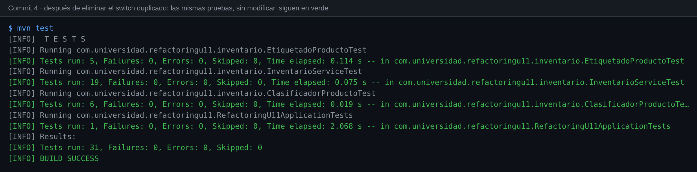

Que las pruebas no se tocaron se puede comprobar con `git diff 8cd3f38 a98712b -- src/test`, que no devuelve nada.

## Parte 2: acoplamiento entre paquetes

### Paso 1: el módulo de reportes y el ciclo que introduce

En el commit [`2385f89`](https://github.com/NicolasSnchz/sanchez-post1-u11-patrones/commit/2385f89b96e8674fa1daf2bc4d71370b5b134bb1) agregué el paquete `reportes` y conecté `InventarioService` con `ReporteBajoStockService` por setter, como pide la guía. La guía deja `generarReporte()` sin implementar; yo lo implementé leyendo los productos bajo el mínimo que expone `InventarioService` con un método nuevo, [`productosBajoStockMinimo()`](https://github.com/NicolasSnchz/sanchez-post1-u11-patrones/blob/2385f89b96e8674fa1daf2bc4d71370b5b134bb1/src/main/java/com/universidad/refactoringu11/inventario/InventarioService.java#L26). La alerta ya no vive dentro de `actualizarInventario()`, porque en la Parte 1 quedó en [`alertarBajoStock()`](https://github.com/NicolasSnchz/sanchez-post1-u11-patrones/blob/2385f89b96e8674fa1daf2bc4d71370b5b134bb1/src/main/java/com/universidad/refactoringu11/inventario/InventarioService.java#L90), así que la llamada al reporte va ahí.

Todas las pruebas siguieron en verde (34), como dice la guía. El problema no lo ve ninguna prueba de negocio: los dos paquetes se importan mutuamente.

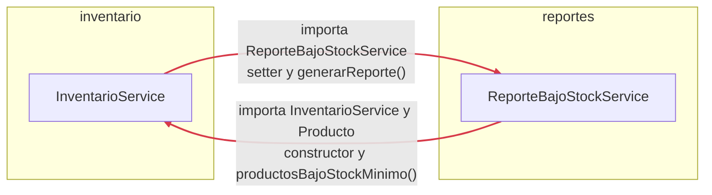

### Paso 2: diagnóstico con una prueba de arquitectura

[`ArquitecturaPaquetesTest`](https://github.com/NicolasSnchz/sanchez-post1-u11-patrones/blob/52c0749298fb00a7f7317b9a3fcf4cd85909b0c3/src/test/java/com/universidad/refactoringu11/ArquitecturaPaquetesTest.java), agregada en [`52c0749`](https://github.com/NicolasSnchz/sanchez-post1-u11-patrones/commit/52c0749298fb00a7f7317b9a3fcf4cd85909b0c3), tiene la regla de la guía y una segunda que agregué:

- [`losPaquetesNoDebenTenerDependenciasCiclicas`](https://github.com/NicolasSnchz/sanchez-post1-u11-patrones/blob/52c0749298fb00a7f7317b9a3fcf4cd85909b0c3/src/test/java/com/universidad/refactoringu11/ArquitecturaPaquetesTest.java#L13): la de la guía, sin cambios.
- [`inventarioNoDebeDependerDeReportes`](https://github.com/NicolasSnchz/sanchez-post1-u11-patrones/blob/52c0749298fb00a7f7317b9a3fcf4cd85909b0c3/src/test/java/com/universidad/refactoringu11/ArquitecturaPaquetesTest.java#L23): fija la *dirección*. Sin ella, la prueba de ciclos también pasaría si alguien "arreglara" el ciclo al revés, haciendo que `reportes` deje de usar `inventario` mientras el dominio sigue importando el módulo de reportes. Además es literalmente lo que exige la rúbrica: que `inventario` no importe nada de `reportes`.

Las dos fallan, y ArchUnit dice exactamente por qué: `Cycle detected: Slice inventario -> Slice reportes -> Slice inventario`, con cada campo, parámetro y llamada que forma el ciclo.

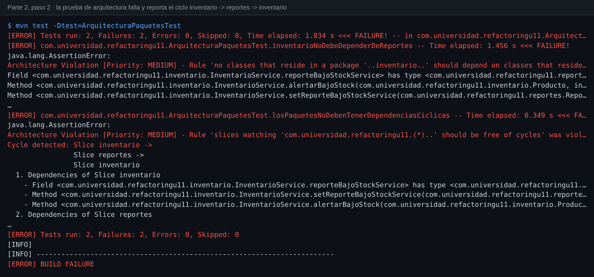

En la misma ejecución, las 34 pruebas restantes pasan, incluidas todas las de la Parte 1. El código compila, el comportamiento es correcto y aun así el diseño está mal: un code smell no es un bug.


### Paso 3: inversión de la dependencia

En el commit [`4413e48`](https://github.com/NicolasSnchz/sanchez-post1-u11-patrones/commit/4413e48e8eec2f04117d109f4f579e52e164d0ef) extraje [`NotificadorBajoStock`](https://github.com/NicolasSnchz/sanchez-post1-u11-patrones/blob/4413e48e8eec2f04117d109f4f579e52e164d0ef/src/main/java/com/universidad/refactoringu11/inventario/NotificadorBajoStock.java) en el paquete `inventario`. `InventarioService` ahora depende solo de esa interfaz ([setter](https://github.com/NicolasSnchz/sanchez-post1-u11-patrones/blob/4413e48e8eec2f04117d109f4f579e52e164d0ef/src/main/java/com/universidad/refactoringu11/inventario/InventarioService.java#L17) y [llamada](https://github.com/NicolasSnchz/sanchez-post1-u11-patrones/blob/4413e48e8eec2f04117d109f4f579e52e164d0ef/src/main/java/com/universidad/refactoringu11/inventario/InventarioService.java#L91)), y `ReporteBajoStockService` la [implementa](https://github.com/NicolasSnchz/sanchez-post1-u11-patrones/blob/4413e48e8eec2f04117d109f4f579e52e164d0ef/src/main/java/com/universidad/refactoringu11/reportes/ReporteBajoStockService.java#L14) guardando la cantidad a reordenar para su próximo reporte. Las dos flechas apuntan ahora hacia `inventario`:

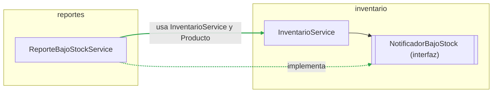

`inventario` ya no importa nada de `reportes`, y la prueba de arquitectura pasa:

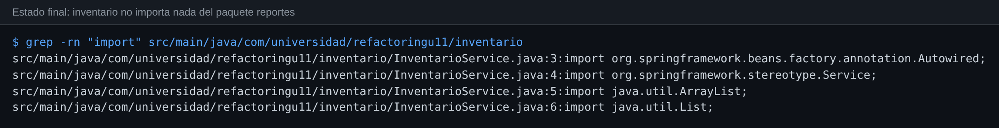

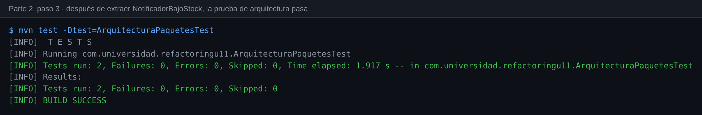

Agregué tres grupos de pruebas para la Parte 2, sin tocar las de la Parte 1:

| Prueba | Qué comprueba | Doble de prueba |
|---|---|---|
| [`InventarioServiceNotificacionTest`](https://github.com/NicolasSnchz/sanchez-post1-u11-patrones/blob/4413e48e8eec2f04117d109f4f579e52e164d0ef/src/test/java/com/universidad/refactoringu11/inventario/InventarioServiceNotificacionTest.java) | Que el inventario notifica una sola vez y con la cantidad correcta cuando un producto baja del mínimo, y que no notifica si no hay reorden ni si el movimiento se rechaza | **Spy** escrito a mano: como `NotificadorBajoStock` tiene un solo método, basta [una lambda](https://github.com/NicolasSnchz/sanchez-post1-u11-patrones/blob/4413e48e8eec2f04117d109f4f579e52e164d0ef/src/test/java/com/universidad/refactoringu11/inventario/InventarioServiceNotificacionTest.java#L23) que anota cada llamada. No uso Mockito ni `verify()`: el contrato observable es "qué se notificó", y las listas lo dicen directo |
| [`ReporteBajoStockServiceTest`](https://github.com/NicolasSnchz/sanchez-post1-u11-patrones/blob/4413e48e8eec2f04117d109f4f579e52e164d0ef/src/test/java/com/universidad/refactoringu11/reportes/ReporteBajoStockServiceTest.java) | El texto del reporte: solo productos bajo el mínimo, con la cantidad notificada, y que un producto repuesto desaparece | Ninguno: uso un `InventarioService` real. Es una clase en memoria y rápida; un stub tendría que copiar su lógica de reorden |
| [`NotificacionBajoStockIntegracionTest`](https://github.com/NicolasSnchz/sanchez-post1-u11-patrones/blob/4413e48e8eec2f04117d109f4f579e52e164d0ef/src/test/java/com/universidad/refactoringu11/NotificacionBajoStockIntegracionTest.java) | Con el contexto real de Spring, que el setter conecta de verdad el reporte como notificador: una salida deja el producto en el reporte con su cantidad | Ninguno: es una prueba de integración |

### Paso 4: las pruebas de la Parte 1 siguen en verde sin modificarse

`mvn verify` en el estado final: **42 pruebas, 0 fallos**, con JDK 17 y con JDK 23. Las tres clases de caracterización son idénticas a como quedaron en el commit [`8cd3f38`](https://github.com/NicolasSnchz/sanchez-post1-u11-patrones/commit/8cd3f38c68aa166ab9fbee0b97a8f39ec54f9627): `git diff 8cd3f38 HEAD -- src/test/java/com/universidad/refactoringu11/inventario/InventarioServiceTest.java src/test/java/com/universidad/refactoringu11/inventario/ClasificadorProductoTest.java src/test/java/com/universidad/refactoringu11/inventario/EtiquetadoProductoTest.java` no devuelve nada.

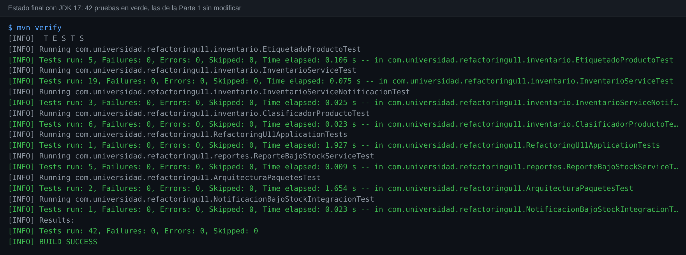

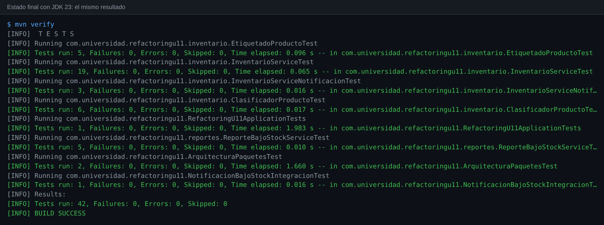

#### Decisión de diseño 3: `NotificadorBajoStock` vive en `inventario`

La regla de la guía es que la infraestructura depende del dominio y el dominio nunca depende de la infraestructura. En este proyecto **`inventario` es el paquete de mayor nivel**: ahí están las reglas del negocio (qué es un movimiento válido, cuándo falta stock, cuánto reordenar). `reportes` es un consumidor de esos hechos que produce una salida. Si mañana el aviso se manda por correo en vez de quedar en un reporte, la regla de reorden no cambia; si cambia la regla de reorden, cambia lo que se avisa.

Por eso la interfaz la define quien la *necesita*, en sus propios términos (`Producto` y la cantidad), y no quien la implementa. Ponerla en `reportes` no resolvería nada: `InventarioService` seguiría importando algo de `reportes`, el ciclo seguiría ahí y la regla `inventarioNoDebeDependerDeReportes` seguiría en rojo.

#### Decisión de diseño 4: notificar por evento y no por lote

El método es `notificar(Producto, int cantidadReorden)` y se llama una vez por cada movimiento que deja un producto bajo el mínimo. Elegí esta granularidad por tres razones:

- **El inventario ya tiene el evento en la mano.** Cada movimiento afecta un solo producto, y el momento en que cruza el mínimo es justo cuando `InventarioService` lo detecta. Un lote obligaría al dominio a acumular avisos y a decidir cuándo enviarlos, que es una responsabilidad de tiempo que no le corresponde.
- **El aviso lleva la cantidad ya calculada.** El notificador no necesita conocer la política de reorden, y por eso la [Decisión 1](#decisión-de-diseño-1-la-reorden-se-queda-como-método-privado) sigue en pie.
- **Es más fácil de probar.** Una interfaz de un solo método se dobla con una lambda.

Preferiría una notificación por lote si avisar fuera caro (un correo, un SMS o una API externa con límite de llamadas), si el destino fuera una orden de compra consolidada al final del día, o si hubiera cargas masivas de movimientos donde mil llamadas seguidas no tienen sentido. Aun así, en ese escenario mantendría la interfaz por evento y haría el lote *dentro* de la implementación. `ReporteBajoStockService` ya funciona así: recibe eventos con `notificar()` y los consolida cuando alguien pide `generarReporte()`.

## Lo que la guía no anticipó: un ciclo entre beans

La guía conecta `InventarioService` con el módulo de reportes por setter "para no tocar la firma que usan las pruebas", y `ReporteBajoStockService` recibe `InventarioService` por constructor. Eso forma un ciclo entre **objetos**, no solo entre paquetes: Spring necesita un bean para crear el otro. Desde Spring Boot 2.6 los ciclos entre beans están prohibidos por defecto, aunque uno de los lados sea un setter.

Lo comprobé ejecutando en GitHub Actions el código de la guía tal cual, sin mi corrección. **La aplicación no arranca**, ni en el Paso 1 ni con el diseño final de la guía:

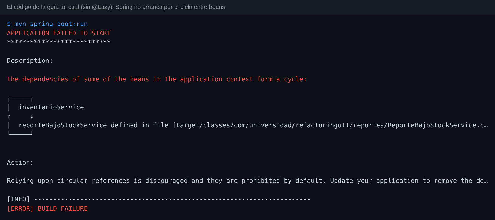

Las pruebas de negocio no lo notan, porque crean los objetos con `new`. Tampoco la prueba de arquitectura, porque mira dependencias entre paquetes y no cómo se crean los objetos. Lo detecta [`contextLoads`](https://github.com/NicolasSnchz/sanchez-post1-u11-patrones/blob/main/src/test/java/com/universidad/refactoringu11/RefactoringU11ApplicationTests.java), la prueba que genera Spring Initializr, que por eso conservé. Con el diseño final de la guía y sin corrección, el ciclo entre paquetes desaparece pero el ciclo entre beans sigue ahí:

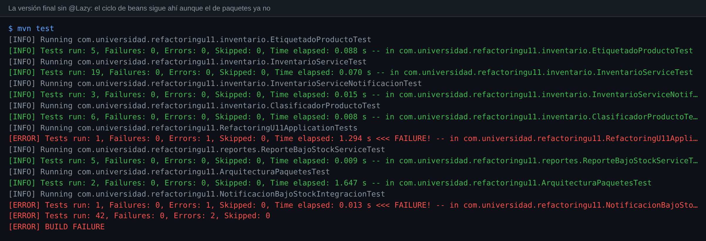

**Cómo lo resolví:** con [`@Lazy` en el parámetro del constructor](https://github.com/NicolasSnchz/sanchez-post1-u11-patrones/blob/main/src/main/java/com/universidad/refactoringu11/reportes/ReporteBajoStockService.java#L20) de `ReporteBajoStockService`. Spring le entrega un proxy que resuelve el `InventarioService` real la primera vez que se usa, y así los dos beans se pueden crear. Lo incluí desde el commit del módulo de reportes, porque el ciclo existe desde ese paso. Descarté las otras salidas:

- **`spring.main.allow-circular-references=true`**: el propio mensaje de Spring lo llama último recurso. Además es global, así que escondería también cualquier ciclo futuro.
- **Quitarle a `ReporteBajoStockService` la dependencia de `InventarioService`**: contradice la guía, que la conserva en la dirección permitida, y el reporte dejaría de mostrar el stock actual.
- **Inyectar `ObjectProvider<InventarioService>`**: funciona igual, pero cambia la firma del constructor que da la guía.

La aplicación arranca en el estado final (`mvn spring-boot:run`):

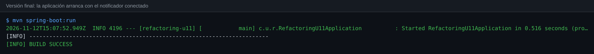

## Evidencia

### Cómo la medí

Maven no puede descargar dependencias desde mi entorno de trabajo, así que toda la medición corrió en GitHub Actions con un flujo temporal ([`medir.sh`](https://github.com/NicolasSnchz/sanchez-post1-u11-patrones/blob/49f978b943987e9b3be53b5e262e12c279e6ecf9/.github/evidencias/medir.sh), commit [`49f978b`](https://github.com/NicolasSnchz/sanchez-post1-u11-patrones/commit/49f978b943987e9b3be53b5e262e12c279e6ecf9)). El flujo:

- Ejecutó cada commit de la Parte 1 tal como está en el historial.
- Aplicó en orden los cambios de la Parte 2 y registró el árbol de `src/` de cada paso. Esos árboles son idénticos a los de los commits [`2385f89`](https://github.com/NicolasSnchz/sanchez-post1-u11-patrones/commit/2385f89b96e8674fa1daf2bc4d71370b5b134bb1), [`52c0749`](https://github.com/NicolasSnchz/sanchez-post1-u11-patrones/commit/52c0749298fb00a7f7317b9a3fcf4cd85909b0c3) y [`4413e48`](https://github.com/NicolasSnchz/sanchez-post1-u11-patrones/commit/4413e48e8eec2f04117d109f4f579e52e164d0ef), como se puede comparar en [`arboles.txt`](docs/evidencias/arboles.txt) con `git rev-parse <commit>:src`.
- Corrió además el código de la guía sin `@Lazy` y comparó ArchUnit 1.3.0 y 1.4.2 en los dos JDK.

Después de medir, el commit [`2290185`](https://github.com/NicolasSnchz/sanchez-post1-u11-patrones/commit/22901854bb6ebde13d4366a2dc1897a485a74787) agregó al `pom.xml` dos opciones de la JVM para quitar las advertencias del agente de Mockito que aparecían en la salida. Solo cambia la salida de las pruebas, no lo que se prueba.

### Valores medidos

| Qué | Valor | Fuente |
|---|---|---|
| Complejidad de `actualizarInventario()` | 13 → 5 | JaCoCo, [antes](docs/evidencias/jacoco/original.xml) y [después](docs/evidencias/jacoco/refactor-parte1.xml) |
| Líneas de `actualizarInventario()` | 44 → 10 | El código en [`4a4a955`](https://github.com/NicolasSnchz/sanchez-post1-u11-patrones/commit/4a4a955d115bd9080fbc4c53208f807fd768fa06) y [`507b0cc`](https://github.com/NicolasSnchz/sanchez-post1-u11-patrones/commit/507b0cca155d5aae39de30ceea16ed9e82dc9b74) |
| Complejidad de `calcularRecargoEnvio` y `generarEtiqueta` | 5 → 1 cada uno | JaCoCo |
| Ramas cubiertas de `actualizarInventario()` por la red de seguridad | 24 de 24 (100 %) | JaCoCo sobre el código original |
| Cobertura de ramas del proyecto en el estado final | 30 de 30 (100 %) | [JaCoCo final](docs/evidencias/jacoco/final.xml) |
| Pruebas | 31 en la Parte 1, 42 al final | Surefire |
| Prueba de arquitectura | 2 fallos con el ciclo, 0 al final | [registro en rojo](docs/evidencias/logs/p2-2-arquitectura.log), [registro en verde](docs/evidencias/logs/p2-3-arquitectura.log) |
| Arranque de la aplicación | Falla con el código de la guía, arranca con `@Lazy` | [falla](docs/evidencias/logs/p2-3-guia-arranque.log), [arranca](docs/evidencias/logs/p2-3-arranque.log) |
| ArchUnit 1.3.0 (la de la guía) con JDK 17 y 23 | Funciona en los dos | [resumen](docs/evidencias/resumen.txt) |

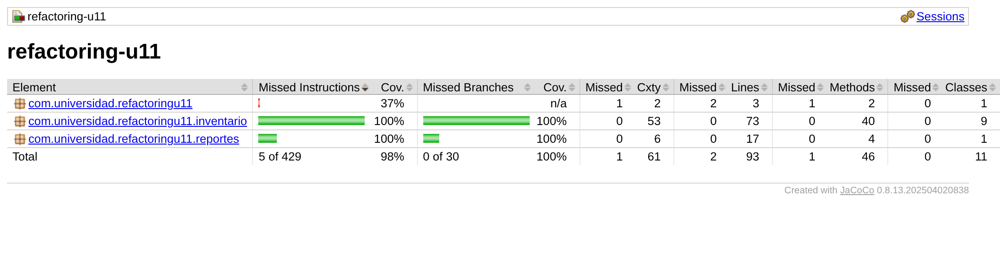

### Todas las capturas

| Captura | Qué muestra |
|---|---|
| [p1-compila-original](docs/capturas/p1-compila-original.png) | El código original compila (`mvn compile`) |
| [p1-pruebas-original](docs/capturas/p1-pruebas-original.png) | La red de seguridad en verde sobre el código original |
| [jacoco-original-inventario](docs/capturas/jacoco-original-inventario.png), [jacoco-original-paquete](docs/capturas/jacoco-original-paquete.png) | Complejidad 13 y 100 % de ramas cubiertas antes del refactor |
| [jacoco-original-clasificador-codigo](docs/capturas/jacoco-original-clasificador-codigo.png) | El `default` inalcanzable del switch |
| [p1-switch-antes](docs/capturas/p1-switch-antes.png), [p1-switch-despues](docs/capturas/p1-switch-despues.png) | Los dos switch, y ninguno después |
| [p1-pruebas-long-method](docs/capturas/p1-pruebas-long-method.png), [p1-pruebas-switch](docs/capturas/p1-pruebas-switch.png) | Las mismas pruebas en verde después de cada refactor |
| [jacoco-refactor-inventario](docs/capturas/jacoco-refactor-inventario.png), [jacoco-refactor-paquete](docs/capturas/jacoco-refactor-paquete.png) | Complejidad 5 y métodos extraídos |
| [p2-pruebas-modulo-reportes](docs/capturas/p2-pruebas-modulo-reportes.png) | Con el módulo de reportes, todo sigue en verde |
| [p2-arquitectura-rojo](docs/capturas/p2-arquitectura-rojo.png), [p2-suite-con-ciclo](docs/capturas/p2-suite-con-ciclo.png) | El ciclo detectado por ArchUnit |
| [p2-arquitectura-verde](docs/capturas/p2-arquitectura-verde.png), [p2-imports-inventario](docs/capturas/p2-imports-inventario.png) | El ciclo resuelto |
| [p2-pruebas-final-jdk17](docs/capturas/p2-pruebas-final-jdk17.png), [p2-pruebas-final-jdk23](docs/capturas/p2-pruebas-final-jdk23.png) | Estado final en los dos JDK |
| [p2-arranque-codigo-guia](docs/capturas/p2-arranque-codigo-guia.png), [p2-pruebas-sin-lazy](docs/capturas/p2-pruebas-sin-lazy.png), [p2-arranque-final](docs/capturas/p2-arranque-final.png) | El ciclo entre beans y su corrección |

### Historial

| Parte | Commit | Mensaje |
|---|---|---|
| Parte 1 | [`4a4a955`](https://github.com/NicolasSnchz/sanchez-post1-u11-patrones/commit/4a4a955d115bd9080fbc4c53208f807fd768fa06) | feat: crear inventario con Long Method en InventarioService y switch duplicado en Clasificador/Etiquetado |
| Parte 1 | [`8cd3f38`](https://github.com/NicolasSnchz/sanchez-post1-u11-patrones/commit/8cd3f38c68aa166ab9fbee0b97a8f39ec54f9627) | test: agregar pruebas de caracterizacion antes de refactorizar (red de seguridad) |
| Parte 1 | [`507b0cc`](https://github.com/NicolasSnchz/sanchez-post1-u11-patrones/commit/507b0cca155d5aae39de30ceea16ed9e82dc9b74) | refactor: eliminar Long Method en actualizarInventario descomponiendo responsabilidades |
| Parte 1 | [`a98712b`](https://github.com/NicolasSnchz/sanchez-post1-u11-patrones/commit/a98712baab8a51feab676a8d861cc2b6e40122fd) | refactor: eliminar switch duplicado sobre TipoProducto con polimorfismo |
| CI y build | [`6eae7de`](https://github.com/NicolasSnchz/sanchez-post1-u11-patrones/commit/6eae7de2d7334341c3930223398a527eb250d2f0) | ci: agregar integracion continua con mvn verify en JDK 17 y 23 |
| CI y build | [`49f978b`](https://github.com/NicolasSnchz/sanchez-post1-u11-patrones/commit/49f978b943987e9b3be53b5e262e12c279e6ecf9) | ci: flujo temporal para medir la evidencia de ambas partes |
| CI y build | [`2290185`](https://github.com/NicolasSnchz/sanchez-post1-u11-patrones/commit/22901854bb6ebde13d4366a2dc1897a485a74787) | build: quitar las advertencias del agente de Mockito al correr las pruebas |
| Parte 1 | [`c8f699f`](https://github.com/NicolasSnchz/sanchez-post1-u11-patrones/commit/c8f699fd3362fbde2771832221fc7beea16fd418) | docs: documentar evidencia de code smells, decisiones de diseno y resultado de pruebas |
| Parte 2 | [`2385f89`](https://github.com/NicolasSnchz/sanchez-post1-u11-patrones/commit/2385f89b96e8674fa1daf2bc4d71370b5b134bb1) | feat: agregar modulo de reportes con notificacion de bajo stock desde inventario |
| Parte 2 | [`52c0749`](https://github.com/NicolasSnchz/sanchez-post1-u11-patrones/commit/52c0749298fb00a7f7317b9a3fcf4cd85909b0c3) | test: agregar prueba de arquitectura que detecta ciclo entre inventario y reportes (en rojo) |
| Parte 2 | [`4413e48`](https://github.com/NicolasSnchz/sanchez-post1-u11-patrones/commit/4413e48e8eec2f04117d109f4f579e52e164d0ef) | refactor: invertir la dependencia entre inventario y reportes extrayendo NotificadorBajoStock |
| CI y build | [`e407faa`](https://github.com/NicolasSnchz/sanchez-post1-u11-patrones/commit/e407faaa78664df1f3fda18bb079f7f33dc3dd05) | ci: retirar el flujo temporal de medicion, con la evidencia guardada en docs |
| Parte 2 | (este commit) | docs: completar README con diagrama de paquetes antes/despues y decisiones de la Parte 2 |

## Checkpoints de la guía y dónde se cumplen

| Checkpoint | Dónde se cumple |
|---|---|
| El proyecto compila con `mvn compile` | [p1-compila-original](docs/capturas/p1-compila-original.png) |
| `actualizarInventario()` tiene más de 35 líneas y mezcla al menos cuatro responsabilidades | 44 líneas y seis bloques en [`4a4a955`](https://github.com/NicolasSnchz/sanchez-post1-u11-patrones/commit/4a4a955d115bd9080fbc4c53208f807fd768fa06) |
| El mismo switch aparece en dos clases | [p1-switch-antes](docs/capturas/p1-switch-antes.png) |
| Las pruebas se escribieron y pasaron antes de modificar el código | [`8cd3f38`](https://github.com/NicolasSnchz/sanchez-post1-u11-patrones/commit/8cd3f38c68aa166ab9fbee0b97a8f39ec54f9627) va antes de cualquier refactor y pasa sobre el código original |
| Las pruebas cubren los cuatro casos de retorno y las cuatro ramas del switch en ambas clases | Los cinco códigos de retorno y las cuatro ramas en las dos clases ([Inconsistencias 2 y 3](#inconsistencias-del-enunciado-y-cómo-las-resolví)) |
| `actualizarInventario()` tiene como máximo 10 líneas y delega con nombres que revelan intención | [10 líneas](https://github.com/NicolasSnchz/sanchez-post1-u11-patrones/blob/507b0cca155d5aae39de30ceea16ed9e82dc9b74/src/main/java/com/universidad/refactoringu11/inventario/InventarioService.java#L17-L26), firma y llave de cierre incluidas |
| Cada método extraído tiene una única responsabilidad | La tabla de responsabilidades de la Parte 1 |
| Ningún switch ni if-else sobre `TipoProducto` | [p1-switch-despues](docs/capturas/p1-switch-despues.png) |
| `calcularRecargoEnvio(Producto)` y `generarEtiqueta(Producto)` conservan su firma | [`ClasificadorProducto`](https://github.com/NicolasSnchz/sanchez-post1-u11-patrones/blob/main/src/main/java/com/universidad/refactoringu11/inventario/ClasificadorProducto.java), [`EtiquetadoProducto`](https://github.com/NicolasSnchz/sanchez-post1-u11-patrones/blob/main/src/main/java/com/universidad/refactoringu11/inventario/EtiquetadoProducto.java) |
| Las pruebas de la Parte 1 siguen en verde sin modificarse | Tabla de resultados por paso y `git diff` vacío |
| `ArquitecturaPaquetesTest` falla con el ciclo | [p2-arquitectura-rojo](docs/capturas/p2-arquitectura-rojo.png) |
| Las pruebas de negocio siguen en verde a pesar del ciclo | [p2-suite-con-ciclo](docs/capturas/p2-suite-con-ciclo.png) |
| `InventarioService` ya no importa nada de `reportes` | [p2-imports-inventario](docs/capturas/p2-imports-inventario.png) y la regla `inventarioNoDebeDependerDeReportes` |
| `ArquitecturaPaquetesTest` pasa en verde | [p2-arquitectura-verde](docs/capturas/p2-arquitectura-verde.png) |
| Mínimo 3 commits por parte | 4 de código en la Parte 1 y 3 en la Parte 2, más los de documentación ([historial](#historial)) |
| Las cuatro decisiones de diseño documentadas | Decisiones [1](#decisión-de-diseño-1-la-reorden-se-queda-como-método-privado), [2](#decisión-de-diseño-2-enum-con-comportamiento-y-no-una-interfaz-de-estrategia), [3](#decisión-de-diseño-3-notificadorbajostock-vive-en-inventario) y [4](#decisión-de-diseño-4-notificar-por-evento-y-no-por-lote) |

## Inconsistencias del enunciado y cómo las resolví

| Qué dice el enunciado | El problema | Cómo lo resolví |
|---|---|---|
| `InventarioService` recibe el reporte por setter y `ReporteBajoStockService` recibe `InventarioService` por constructor | Es un ciclo entre beans. Spring Boot lo prohíbe desde la versión 2.6 y la aplicación no arranca, ni en el Paso 1 ni con el diseño final | `@Lazy` en el constructor de `ReporteBajoStockService`, con la evidencia en [su propia sección](#lo-que-la-guía-no-anticipó-un-ciclo-entre-beans) |
| El checkpoint del Paso 2 pide cubrir las cuatro ramas del switch en ambas clases | `EtiquetadoProductoTest` solo trae LIBRO y ELECTRONICO | Agregué ROPA y ALIMENTO en el mismo commit de caracterización, antes de cualquier refactor |
| El mismo checkpoint habla de los "cuatro casos de retorno" de `actualizarInventario` | Son cinco: también está `ERROR_PRODUCTO_NO_EXISTE` | Están cubiertos los cinco |
| El Paso 4 de la Parte 2 muestra `Tests run: 12` | 12 son solo las pruebas de la guía para la Parte 1. Con `contextLoads` de Spring Initializr y la prueba de arquitectura, la suite de la guía ya no daría 12 | Reporto el número real: 42 (30 de caracterización, `contextLoads`, 2 de arquitectura y 9 de la Parte 2) |
| Los checkpoints finales hablan de "las cuatro pruebas de caracterización de la Parte 1" | La guía trae 12, en tres clases | Lo interpreto como todas las pruebas de caracterización, y ninguna cambió |
| El Paso 1 de la Parte 2 inserta la llamada al reporte dentro de `actualizarInventario()`, con su forma original | En la Parte 1 ese método quedó en 10 líneas y la alerta pasó a `alertarBajoStock()` | La llamada va en [`alertarBajoStock()`](https://github.com/NicolasSnchz/sanchez-post1-u11-patrones/blob/2385f89b96e8674fa1daf2bc4d71370b5b134bb1/src/main/java/com/universidad/refactoringu11/inventario/InventarioService.java#L90) |
| `generarReporte()` "recorre los productos bajo stock mínimo expuestos por `InventarioService`" | `InventarioService` no expone esos productos en ningún paso | Agregué [`productosBajoStockMinimo()`](https://github.com/NicolasSnchz/sanchez-post1-u11-patrones/blob/2385f89b96e8674fa1daf2bc4d71370b5b134bb1/src/main/java/com/universidad/refactoringu11/inventario/InventarioService.java#L26), que reutiliza `necesitaReorden` |
| El primer commit hace `git add pom.xml src/main/java/...` | Deja fuera el `.gitignore` y el `application.properties` que genera Spring Initializr | Los incluí en el primer commit |
| "No marcar Add a README ni agregar .gitignore (el proyecto de Spring Initializr ya incluye ambos)" | Spring Initializr genera el `.gitignore` y un `HELP.md`, pero no un README | Escribí este README |
| El repositorio se llama `apellido-post1-u11` | | Lo llamé `sanchez-post1-u11-patrones` para mantener el mismo nombre que mis entregas anteriores |

## Otras decisiones y limitaciones conocidas

**Otras decisiones**

- **Spring Boot 4.1.1 con Java 17**, como pide la guía. Compila con `--release 17` y la verifiqué con JDK 17 y JDK 23, que es el que tengo instalado.
- **ArchUnit 1.3.0**, la versión de la guía. La guía habla de JUnit 5, pero Spring Boot 4.1 trae JUnit 6.0.3. Las pruebas usan la misma API (`org.junit.jupiter`), y antes de dejar ArchUnit 1.3.0 comprobé que funciona con JUnit 6 y con los dos JDK; la 1.4.2 da el mismo resultado.
- **JaCoCo en el `pom.xml`**: la guía no lo trae, pero la rúbrica pide evidencia de complejidad, y es lo que da la complejidad por método y la cobertura de ramas.
- **Un flujo de CI permanente** ([`ci.yml`](https://github.com/NicolasSnchz/sanchez-post1-u11-patrones/blob/main/.github/workflows/ci.yml)) corre `mvn verify` con JDK 17 y 23 en cada push. Es el que da el badge del principio.

**Limitaciones conocidas** (vienen del código del enunciado y las dejé a propósito)

- **Los comportamientos raros del original siguen ahí**: una ENTRADA con cantidad negativa puede dejar el stock negativo, y un `tipoMovimiento` o un tipo de producto `null` lanzan `NullPointerException`. Las pruebas de caracterización los fijan a propósito. Corregirlos es un cambio de comportamiento que debería ir en su propio commit, con pruebas nuevas, no mezclado con un refactor.
- **`movimientos` se escribe y nunca se lee.** Es el registro de auditoría del enunciado. No le agregué un getter porque nadie lo pide.
- **La salida va a `System.out`.** Las pruebas de caracterización la fijan; pasar a un logger sería el siguiente paso.
- **`ClasificadorProducto` y `EtiquetadoProducto` quedaron como intermediarios** (Middle Man) que solo delegan en el `enum`. Los conservé porque la guía exige sus firmas. Si nadie más las usara, se podrían eliminar con Inline Class.
- **Los servicios no son seguros para hilos** (una `ArrayList` y un `HashMap` en beans singleton). Para este laboratorio no hay concurrencia, pero en una aplicación web habría que protegerlos.

## Estructura, ejecución y herramientas

```text
src/main/java/com/universidad/refactoringu11/
├── RefactoringU11Application.java
├── inventario/      Producto, TipoProducto, InventarioService, ClasificadorProducto, EtiquetadoProducto, NotificadorBajoStock└── reportes/        ReporteBajoStockService
src/test/java/com/universidad/refactoringu11/
├── RefactoringU11ApplicationTests.java, ArquitecturaPaquetesTest.java, NotificacionBajoStockIntegracionTest.java├── inventario/      pruebas de caracterización y de la notificación└── reportes/        pruebas del reporte
docs/capturas        capturas de las ejecuciones reales
docs/evidencias      registros completos, reportes de JaCoCo y de CPD
```

```bash
mvn test                                    # toda la suite
mvn test -Dtest=ArquitecturaPaquetesTest    # solo la prueba de arquitectura
mvn verify                                  # pruebas y reporte de JaCoCo en target/site/jacoco
mvn spring-boot:run                         # arranca la aplicación (no expone web: arranca y termina)
```

**Herramientas:** Java 17 (probado también con JDK 23), Spring Boot 4.1.1, Maven, JUnit 6 (la que trae Spring Boot 4.1), ArchUnit 1.3.0, JaCoCo 0.8.13, PMD CPD, GitHub Actions, Git y GitHub.

## Conclusiones

Lo que más me sirvió fue escribir la red de seguridad antes de tocar nada: las pruebas de los bordes y de la consola me frenaron en dos refactors que se veían inofensivos, como validar `null` o revisar el stock también en las entradas, y que habrían cambiado el comportamiento sin que nadie lo notara. También entendí que no toda duplicación es texto copiado: CPD no vio los dos `switch` porque lo repetido era la estructura de decisión, y eso solo se quita con polimorfismo. En la Parte 2 quedó claro que un problema de diseño puede convivir con todas las pruebas en verde, y que se necesita una prueba que mire la arquitectura para verlo. Y el hallazgo más útil fue que invertir la dependencia arregló el ciclo entre paquetes pero no el ciclo entre objetos: ninguna de las dos pruebas de la guía lo veía, y solo apareció al arrancar el contexto real de Spring.
